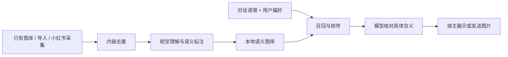

<div align="center">
  
  <h1>Meme Studio · 表情工作台</h1>
  <p><strong>让 AI 找到表情，也读懂表情。</strong></p>
  <p>定期采集 · 语义标注 · 对话选图 · 本地图库</p>
  <p><a href="docs/FIRST-RUN.md">上手指南</a> · <a href="INSTALL-IN-DSH.md">交给 AI 安装</a> · <a href="docs/API.md">接口文档</a> · <a href="LICENSE">MIT License</a></p>
</div>

Meme Studio 是一个带本地控制台的表情包 Skill。它从小红书收集表情，利用视觉模型标注文字、具体含义和使用场景，再让 AI 根据对话挑选合适的图片。

你可以连接已有图库，也可以从空库开始，让它定期寻找“奶龙”“猫咪”“打工人”等方向的新表情。已理解的图片会复用标注，无需每次聊天重新看图。

## 核心功能

| 能力 | 可以做什么 |
| --- | --- |
| **定向采集** | 输入角色、主题或关键词，搜索小红书表情；优先近期、带文字的图片，下载后按内容去重。 |
| **定期更新** | 在控制台开启采集、设置 1–720 小时间隔，也可以立即采集一轮。 |
| **读懂表情** | 提取图中文字、具体含义、表达意图、情绪、风格、适用与不适用场景，区分反话及表达对象。 |
| **按语境选图** | 同意图优先，也允许相近表达和轻松场景下的抽象联想；结合具体文案判断，不要求标签完全一致。 |
| **使用自己的图库** | 连接已有文件夹，或导入图片；控制台预览图片、查看和修改标注，保留原文件。 |
| **可调聊天规则** | 每轮一张、自然适量、仅用户要求；支持 12 种风格和“跟随聊天”，近期用过的图片降低优先级。 |

## 可以这样和 AI 说

> 找一批奶龙表情包，标注它们的含义，存进图库。

> 每 84 小时收集一次猫咪表情。

> 连接我这个文件夹，看看已有表情适合怎么接话。

> 根据这段对话挑一张合适的表情，解释为什么选它。

## 它怎样选图？



例如用户说“谢谢”，AI 应考虑表达“不客气”的回应，而不是机械地匹配“感谢”标签；用户开玩笑说“少花我点 token”，不应擅自修改表情频率。抽象表情可以参与轻松聊天，但不能忽略图片本身的反话、攻击方向或不适用场景。

选图每次最多返回 6 个候选。已删除、未完成理解和明确不适用的图片不参与；模型再根据 `text / meaning / when / target / avoid` 做最后判断。详见 [选图与使用规则](skills/meme-studio/references/delivery.md)。

## 快速开始

### 1. 下载完整项目

点击仓库上方 **Code → Download ZIP**，解压到固定目录；也可以：

```bash
git clone https://github.com/jqiankun8866/meme-studio.git
cd meme-studio
```

### 2. 打开控制台

安装 **Node.js 24 或以上**，双击 `打开表情工作室.cmd`。也可在项目目录运行：

```powershell
.\start.ps1
```

无需 `npm install`。启动器会打开带访问令牌的本机地址，默认端口为 `17961`。首次图库为空，自动采集关闭；本项目不附带表情图片，页面角色图仅用于界面标识。

### 3. 接入 AI

将完整项目路径发给支持本机命令与文件访问的 AI：

> 请阅读这个项目的 INSTALL-IN-DSH.md 和 skills/meme-studio/SKILL.md，检查依赖、启动服务并接入技能，然后按模型验收用例测试连接和选图，不发送消息。

也可将 `skills/meme-studio` 安装到宿主支持的技能目录。**需要保留完整项目并运行服务，只有 SKILL.md 不够。**

### 4. 建立图库

- **已有图片：** 在控制台填写图库的完整路径，或点击“导入图片”。支持 PNG、JPEG、GIF、WebP 和子文件夹。
- **采集新图：** 准备 Chrome、FFmpeg 和 Windows 中文 OCR，在“连接与自检”中连接浏览器并完成本人登录，填写采集方向后点击“立即采集”。
- **理解图片：** 让当前 AI 实际看图并标注；需要无人值守批量处理时，再配置 [后台视觉模型](docs/VISION.md)。

完整步骤、依赖检查与常见情况见 [第一次使用](docs/FIRST-RUN.md)。

## 模型与平台适配

Skill 使用 Markdown 规则、本地客户端和 HTTP 接口，不绑定某个模型品牌或聊天平台。

| 使用方式 | 需要什么 |
| --- | --- |
| 读取规则、按已有标注选图 | 宿主能阅读 Skill，并执行 Node 客户端或本机 HTTP 请求。 |
| 理解新图片 | 宿主具有真实图片读取能力，或配置兼容 Chat Completions 的视觉服务。 |
| 在 QQ、微信等平台使用 | 宿主按自身能力展示或发送所选图片；本项目不包含账号登录和消息通道。 |

DSH、Codex、Claude 等可按宿主实际支持的技能机制接入。**服务能连接、模型能理解规则、图片能读取是不同验收项**；不承诺所有宿主开箱即用。[模型验收用例](skills/meme-studio/references/model-check.md) 不需要发送任何消息。

控制台里的聊天设置由宿主调用 Skill 时使用。安装 Skill 或打开网页本身不会自动监听所有对话。

## 运行说明

- **当前完整采集链路面向 Windows。** Node.js 24+ 为必需；Chrome、FFmpeg、Windows OCR 用于小红书采集。依赖和模型额度不随包提供。
- 定期采集和后台标注依赖服务持续运行；不自动注册开机启动。采集受登录状态和页面变化影响，不保证每轮有新增。
- 每轮采集最多检查 5 篇笔记、12 张图片，最多收录 5 张。后台标注每批最多 3 张，低置信度图片保留待确认。
- 默认数据位于用户目录 `.meme-studio`。用 `MEME_STUDIO_DATA` 和 `MEME_STUDIO_PORT` 可调整数据目录和端口。已有图库只读连接，断开不会删除原图。
- 图片、标注和设置保存在本机；采集会访问小红书，视觉标注会把图片交给所使用的模型服务。请勿公开私人数据目录或访问令牌。

## 文档

- [首次使用与环境准备](docs/FIRST-RUN.md)
- [交给 AI 安装配置](INSTALL-IN-DSH.md)
- [后台视觉模型配置](docs/VISION.md)
- [规则与选图流程](skills/meme-studio/references/delivery.md)
- [模型连接与理解验收](skills/meme-studio/references/model-check.md)
- [HTTP API](docs/API.md)
- [测试范围与验证记录](docs/RELEASE-CHECK.md)

## 开发与贡献

Node.js 24+，无第三方 npm 运行时依赖：

```bash
npm test
npm start
```

测试覆盖图库导入与去重、标注队列、调度、候选排序、场景排除、频率设置和回执。自动测试中的浏览器、模型与发送结果使用模拟适配器；真实模型理解需另行执行验收用例。

欢迎通过 Issue 反馈宿主适配、误选表情和采集问题，或提交 PR。请附复现步骤和脱敏日志，不上传账号凭证、私人图库或聊天记录。发布文件校验使用 `python scripts/verify-distribution.py`；维护者确认改动后可用 `--write` 更新清单。

## 许可与来源

代码采用 [MIT License](LICENSE)，代码来源及外部依赖见 [第三方声明](THIRD_PARTY_NOTICES.md)。使用者图片和采集素材的权利不包含在代码许可内；本仓库不分发采集图库。
